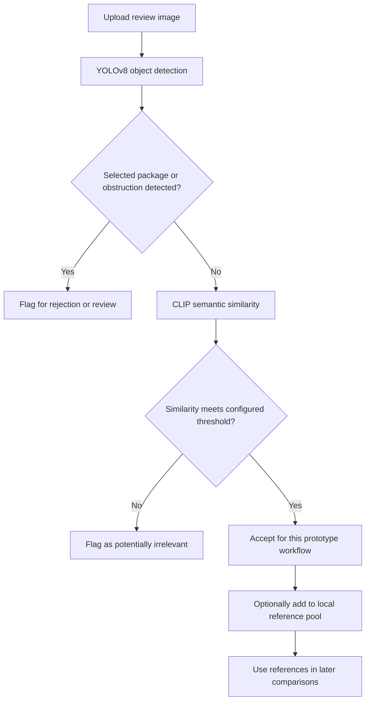

<p align="center">
  
  
  
  
</p>

# Smart E-Commerce Review Moderation System

A Python and Streamlit prototype that explores automated checks for product-review images on e-commerce platforms. The system combines object detection and image–text similarity to help flag images that may be irrelevant to a selected product.

> **Project status:** Experimental portfolio project. Its decisions should be treated as moderation suggestions, not as a production-ready or fully autonomous moderation service.

## How it works

The prototype uses a two-stage workflow:

1. **Object detection with YOLOv8:** scans an uploaded image for selected objects such as shipping boxes, packages, or bags.
2. **Semantic similarity with CLIP:** compares the image with product-related text or reference images to estimate whether the content is relevant.
3. **Reference pool:** images accepted by the configured threshold can be added to a local reference collection for later comparisons.
4. **Batch feedback:** the Streamlit interface displays processing progress and a running estimate based on observed processing time.

## Main features

- Two-stage image analysis using YOLOv8 and CLIP.
- Configurable similarity threshold (the current workflow uses a 65% threshold).
- Multi-reference comparison using the maximum similarity score.
- Local reference storage and timestamp-based file naming.
- Streamlit interface for individual and batch processing.
- Logging and early-stop checks intended to reduce unnecessary processing.

## Technology stack

- Python 3.10+
- Streamlit
- Ultralytics YOLOv8
- PyTorch
- Hugging Face Transformers (CLIP)
- Pillow

## Run locally

Clone the repository:

```bash
git clone https://github.com/BerkayYLMZ53/E-Commerce-Image-Moderation-System.git
cd E-Commerce-Image-Moderation-System
```

Install the main dependencies:

```bash
pip install streamlit torch transformers ultralytics pillow
```

Start the application:

```bash
streamlit run app.py
```

If the project includes a `requirements.txt` file, prefer installing from it:

```bash
pip install -r requirements.txt
```

## Workflow



## Important limitations

- Similarity scores are model outputs, not calibrated probabilities that an image is genuine or relevant.
- The 65% threshold is a configurable heuristic and must be validated on representative, labelled data before practical deployment.
- Automatically adding accepted images to a reference pool can introduce noisy or biased examples. Human review and safeguards are important.
- The project has not established a measured false-negative rate or production-level moderation accuracy. No such performance guarantee is claimed.
- The prototype is not a replacement for human moderation, platform policies, or a production security review.

## Project motivation

This project was developed as an independent R&D exercise around image quality and relevance in e-commerce. It combines computer vision, multimodal models, and a lightweight application interface to explore how data-driven moderation workflows can be designed.

